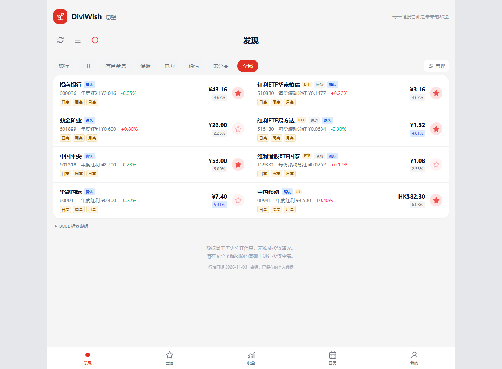
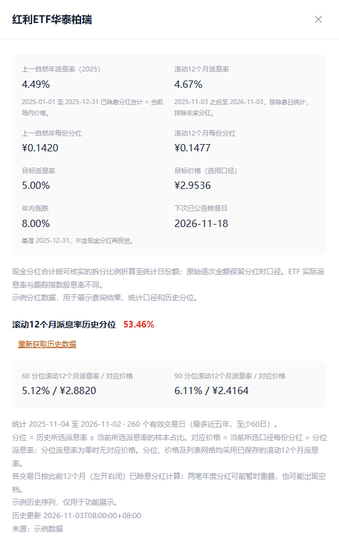
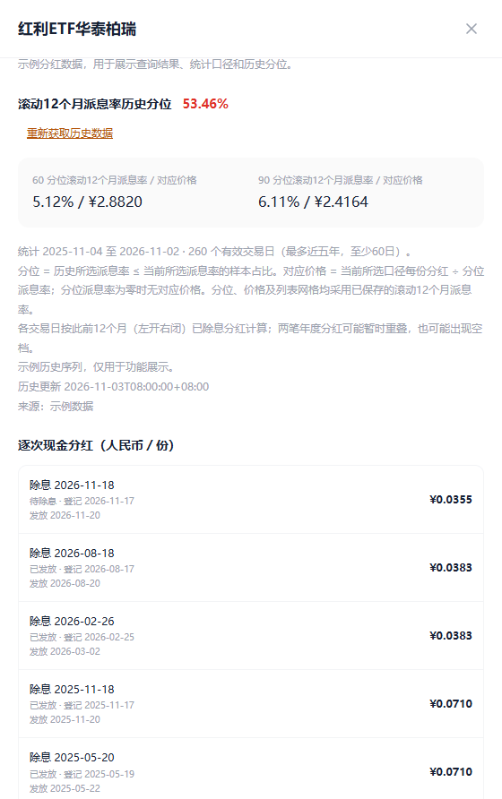
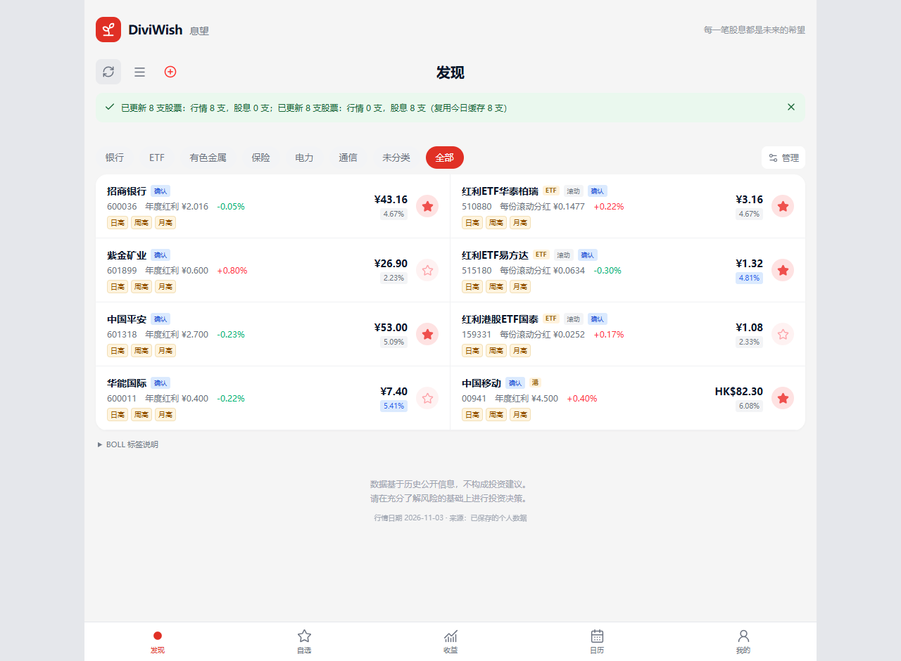
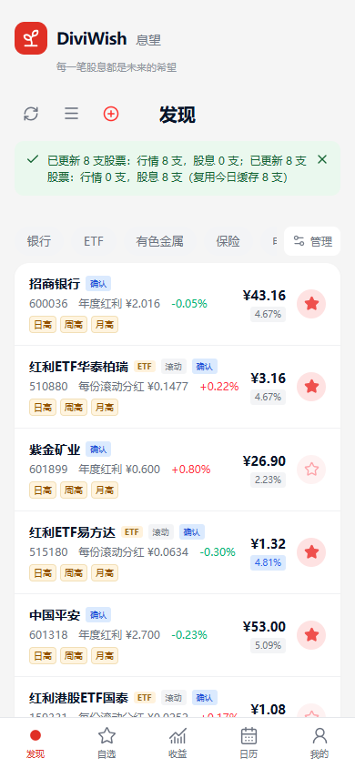
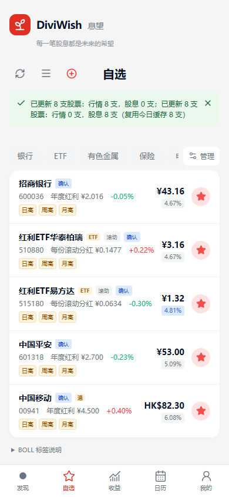
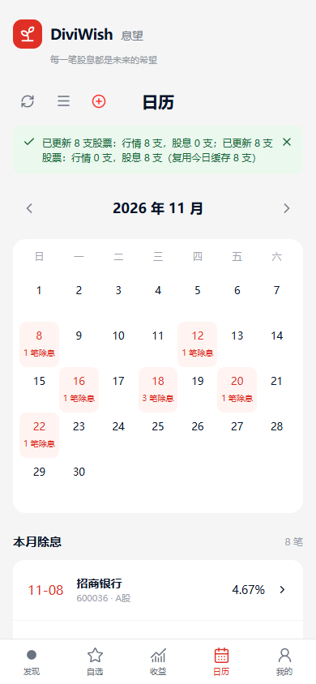

# DiviWish · 息望

**每一笔股息，都是未来的希望。**

面向 A 股、港股和沪深 ETF 的股息观察工具，帮你整理自选、跟踪分红，比较股息率与历史估值位置。

使用邮箱密码或 LinuxDO 登录，在电脑和手机上查看自己的观察列表。

[立即使用](https://diviwish.shaunko.tech) · [功能更新](web/docs/release-notes.md) · [使用说明](web/docs/index.md)

## 自定义每股股息（2026-11-07）

- 选用“自定义每股股息”后，可填写固定金额、币种和备注；ETF 对应每份分红。
- 股息率按“每股股息 ÷ 当前股价”计算，币种不同时先换算。报价变化只更新股息率，不改写已保存金额。
- 列表、排行、目标价格与买卖网格沿用所选口径；独立手动预估入口已合并移除，原有可用人工金额会保留转换。

## 这次更新了什么（2026-11-03）

- **Windows / Linux 一键启动**：Windows 双击 `web/run.cmd`，Linux 运行 `web/run.sh`，自动安装依赖、构建和启动，后续复用未变化的结果。

- **刷新先看到新价格**：价格更新后立即显示，再检查分红，减少等待慢分红查询时的空转。
- **分红每天获取一次**：按北京时间自然日，首次成功获取后当天复用；失败保留已有值，稍后刷新重试。多个用户关注同一标的时复用公开分红，各自的观察列表、手工值和设置仍独立。
- **长列表刷新可以续查**：一轮没查完的标的，下次刷新会优先继续，不会总是重复查询前面的股票。
- **ETF 除息日历更完整**：手工填写的日期也能进入日历，与查询日期合并，同一标的同一天只显示一次。

近期还加入了沪深 ETF 的年度／滚动派息率、逐次分红和历史分位，以及新用户默认观察标的。完整变化见[更新记录](web/docs/release-notes.md)。

## 可以做什么

| 功能 | 你可以看到和操作的内容 |
| --- | --- |
| A 股、港股与沪深 ETF | 按名称或代码添加标的，自动识别市场和证券类型；按市场、板块和关键词筛选。 |
| 自选与板块 | 点击星标加入自选，自定义板块；删除板块后，标的保留在“未分类”。 |
| 行情与分红 | 查看价格、涨跌、分红确认状态和来源，刷新或手动核对年度／滚动分红。 |
| 多种股息率口径 | 保存年度、滚动年度或自定义选择，设定目标股息率，查看对应目标价格。 |
| ETF 派息观察 | 查看上一自然年和滚动12个月派息率、每份分红、登记日、除息日及发放日；区分已发放和待除息。 |
| 历史分位 | 查看当前所选口径的历史百分位、30／60／90 分位及对应价格；个股提供历史曲线，ETF 显示派息率分位与实际样本区间。 |
| 股息率网格 | 为每个标的独立设置买入、卖出起止股息率，共用步长；买入逐档递增、卖出逐档递减，比较对应价格与达标状态。 |
| BOLL 标签与通道 | 列表直接显示日、周、月位置标签；详情切换周期，查看当前价格与上、中、下轨的关系。 |
| 年内涨跌与支付率 | 查看年内涨跌的价格基准；个股可查看同财年的年度股息支付率及缺失原因，ETF 不使用个股支付率。 |
| 股息率排行与 A/H 对比 | 按股息率或历史分位排序，比较 A/H 溢价和不同港股股息折算口径。 |
| 除息日历 | 按月查看已记录和已公告的日期，从日历进入标的详情。 |
| 个人账号与多端访问 | 邮箱密码或 LinuxDO 登录，电脑、手机共用自己的观察列表；各账号的数据独立。 |

## 界面预览

以下截图来自当前版本，使用**临时演示数据**，不代表实时行情、实际持仓或分红预测。

### 发现、自选与 BOLL 标签

股票与 ETF 放在同一张观察列表中，保留各自的派息口径、板块和关注状态。

### ETF 派息详情与历史分位

查看每份分红、上一自然年和滚动12个月派息率，以及所选口径的历史分位和对应价格。

<table>
  <tr>
    <td width="50%" valign="top"></td>
    <td width="50%" valign="top"></td>
  </tr>
</table>

### 每日分红缓存

刷新时先显示价格；当天已有分红结果时会提示“复用今日缓存”。当天首次获取分红仍可能需要等待，已有价格会先更新。

### 手机浏览与除息日历

  
  
  

## 开始使用

1. 打开[息望](https://diviwish.shaunko.tech)，使用邮箱密码或 LinuxDO 登录。
2. 首次使用会提供招商银行（600036）和红利ETF华泰柏瑞（510880）两个观察标的，点击刷新获取价格和分红；也可删除或继续添加。
3. 点击“＋”，输入名称或完整代码；同名标的请从搜索结果中选择，核对资料后保存。
4. 用星标整理自选，按板块和市场筛选；进入详情保存自己的股息率口径、目标和价格网格。
5. 在“收益”比较股息率排行，在“日历”查看已记录的除息安排。

已有邮箱账号请先用邮箱登录，再在“我的”中绑定 LinuxDO，即可用两种方式访问原有数据。

已有观察列表不会自动补入默认标的，删除默认标的后也不会再次添加。

## 使用说明

- 股息率有年度、滚动年度和自定义口径，比较前请确认所选口径一致；自定义历史分位属于估算回溯。
- ETF 按除息日统计现金分红，待除息记录不计入已除息合计；除息日与现金发放日分别展示。
- 历史分位需要至少 60 个有效样本；数据不足、未派息或来源无法核实时，会说明原因。
- 查询失败会保留已有数据；缺失分红不会直接填成零，日历也不会猜测未公告的日期。
- “收益”用于股息率观察和比较，不估算未录入的持仓实际收益。

[股息与历史分位说明](web/docs/calculations.md) · [ETF 使用说明](web/docs/etf.md) · [安装与运行](web/docs/setup.md) · [文档目录](web/docs/index.md)

网站信息用于观察和记录，不构成投资建议。

## 致谢与许可

感谢 [LINUX DO 社区](https://linux.do/) 的开放交流与技术分享。在线使用支持 LinuxDO 授权登录。

项目采用 [MIT 许可证](LICENSE)。
