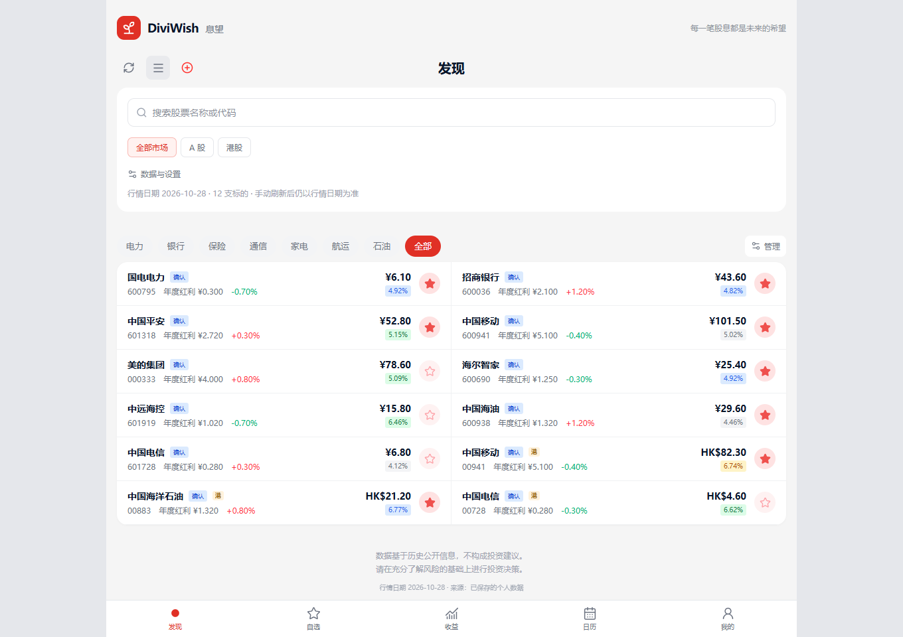
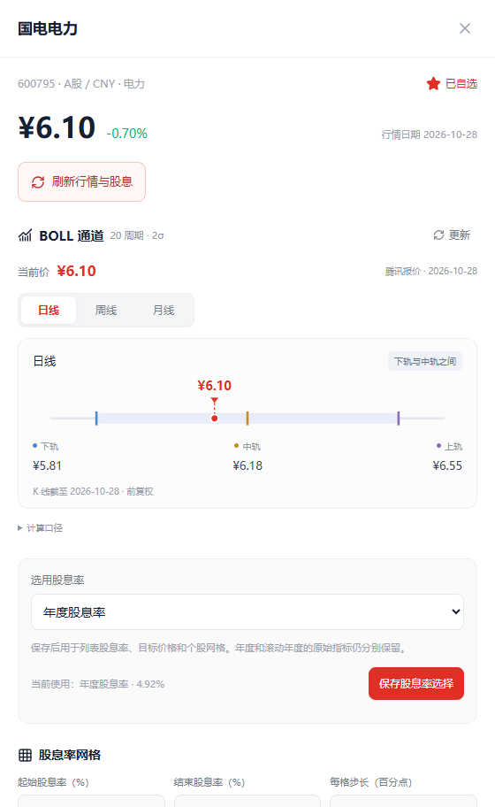
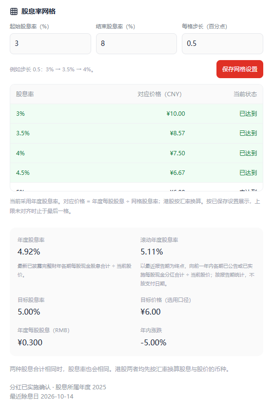
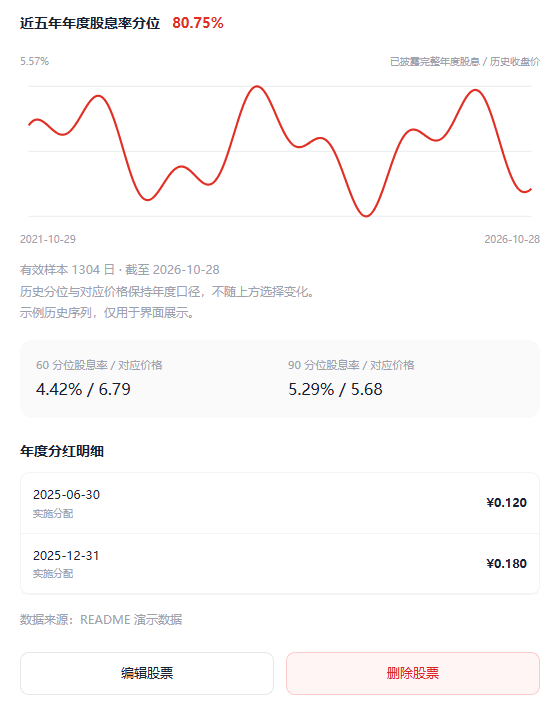
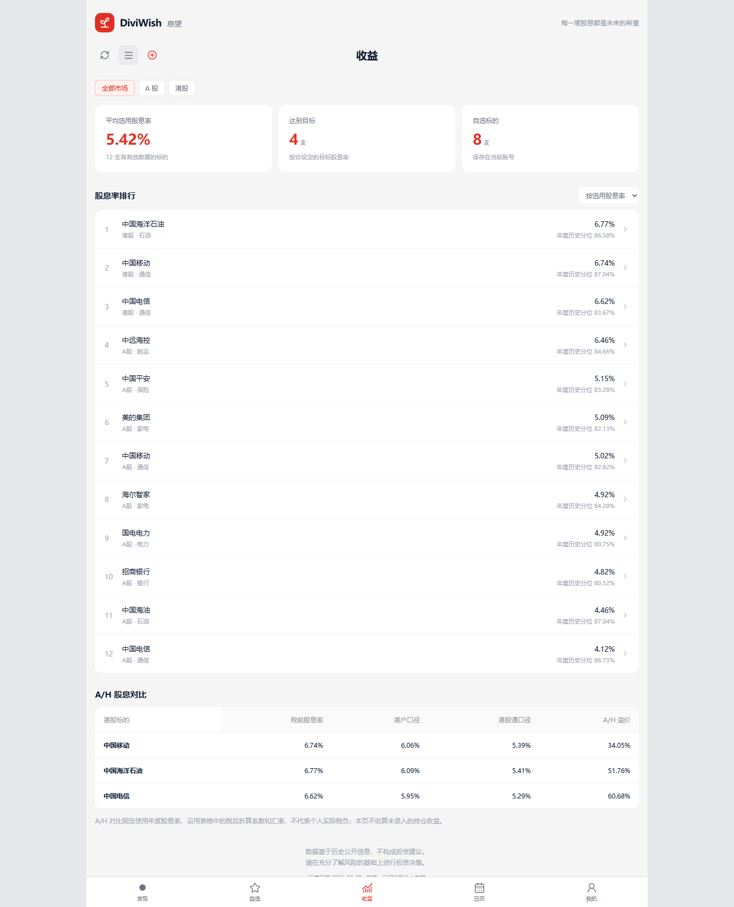
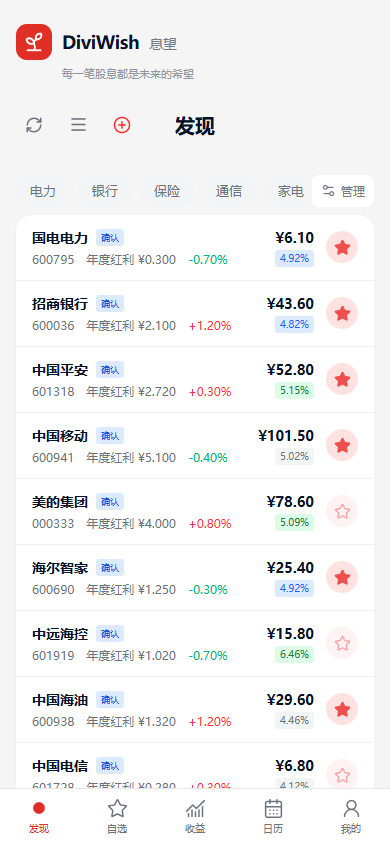
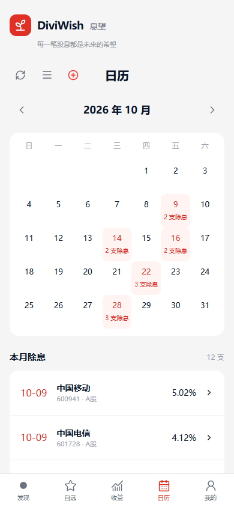
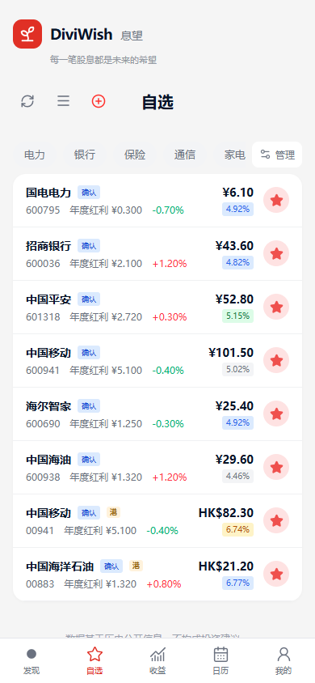

<div align="center">


# DiviWish · 息望（多人版）

**每一笔股息，都是未来的希望。**

一个面向 A 股与港股的股息观察网站，帮助你整理自选、跟踪分红，比较股息率与历史估值位置。

[进入网站](https://diviwish.shaunko.tech) · [登录 / 注册](https://diviwish.shaunko.tech/login) · [本地部署说明](web/README.md)

Next.js 16 · React 19 · TypeScript · Cloudflare Workers · D1 / SQLite

</div>

## 版本与分支选择

单机版和多人版均维护在本仓库，按使用方式选择分支：

| 分支 | 适合场景 | 账号与存储 |
| --- | --- | --- |
| [main](https://github.com/gxcuit/DiviWish/tree/main) | 个人本机使用，单机稳定版 | 无需登录注册，本地 SQLite，支持 npm / Docker |
| [multi-user](https://github.com/gxcuit/DiviWish/tree/multi-user) | 多人使用，账号稳定版 | 邮箱密码或 LinuxDO 登录、注册与用户数据隔离；本地 SQLite / Cloudflare D1 |
| [codex/standalone](https://github.com/gxcuit/DiviWish/tree/codex/standalone) | 单机版开发 | 对应 `main` 的开发分支 |
| [develop](https://github.com/gxcuit/DiviWish/tree/develop) | 多人版开发 | 对应 `multi-user` 的集成分支 |

首次下载单机版可运行 `git clone --branch main https://github.com/gxcuit/DiviWish.git`；多人版将 `--branch main` 改为 `--branch multi-user`。安装与部署请阅读所选分支的 [web/README.md](web/README.md)。

原 `DiviWish-private` 仓库已停用。通用功能与 bug 修复同步维护两版，各版专属的账号、数据库与部署逻辑分别保留。详细约定见 [分支说明](web/docs/branches.md) 和 [项目记忆](MEMORY.md)。


## 可以做什么

| 功能 | 说明 |
| --- | --- |
| LinuxDO 与邮箱登录 | 使用 LinuxDO 授权登录，或通过邮箱验证码注册、邮箱密码登录；支持找回密码。已有邮箱账号可绑定 LinuxDO，共用原有数据。 |
| A/H 股息观察 | 查看价格、涨跌、年度每股股息、分红确认状态和股息率，按市场、板块、股票名称或代码筛选。 |
| 自选与板块管理 | 星标关注股票，新增和编辑标的，自定义板块；删除板块后，股票保留在“未分类”。 |
| 行情与分红更新 | 查询当前价格与股息，刷新年度 / 滚动股息、所属财年、实施状态和分红明细，支持手动核对与维护。 |
| 多种股息率口径 | 每只股票可选择年度、滚动年度或自定义股息率，并保存自己的目标股息率和对应目标价格。 |
| 历史分位与价格网格 | 自动补齐近五年年度股息率历史，查看历史分位、60 / 90 分位对应价格，并设置每只股票的股息率网格。 |
| BOLL 通道 | 在个股详情中切换日线、周线、月线，观察当前价格相对 BOLL(20, 2) 上轨、中轨和下轨的位置。 |
| 股息率排行与 A/H 对比 | 按选用股息率或历史分位排序，比较港股税前、港户及港股通折算口径，以及 A/H 溢价。 |
| 除息日历 | 按月份查看已记录的除息日期，点击日期或列表进入股票详情。 |
| 个人账号与多端访问 | 股票、自选、板块和设置保存在服务端，按账号隔离；桌面和手机均可浏览。 |

## 界面预览

以下截图来自当前版本的真实页面，使用**临时演示账号与示例数据**，用于展示功能，不代表实时行情或分红预测。

### 发现、筛选与自选

在一个页面查看 A 股与港股，按行业和市场缩小范围，点击星标加入自选。



### LinuxDO 与邮箱密码登录

已有账号先用邮箱密码登录，再进入“我的 → 绑定 LinuxDO”，以后两种登录方式使用同一个账号。


### 个股详情、BOLL 与历史分位

从价格通道、股息率网格到历史曲线与分红明细，集中查看一只股票的观察指标。

<table>
  <tr>
    <td width="50%" valign="top"></td>
    <td width="50%" valign="top"></td>
  </tr>
</table>

<p align="center"></p>

### 股息率排行与 A/H 对比

“收益”页面提供股息率排行、达到目标的标的统计，以及 A/H 股息口径对比。



### 手机浏览、自选与除息日历

<p align="center">
  
  
  
</p>

## 开始使用

1. 打开 [息望](https://diviwish.shaunko.tech)，使用 LinuxDO 登录，或注册邮箱账号。
2. 新账号初始为空。进入“发现”，点击“＋”添加股票，可通过名称或代码搜索。
3. 点击“获取当前价格与股息”，核对资料、设置板块与目标股息率后保存。
4. 用星标整理自选；点击股票查看 BOLL、股息率网格、历史分位和分红明细，也可进入“收益”或“日历”继续观察。

已有邮箱账号请在登录后绑定 LinuxDO。直接在登录页首次使用 LinuxDO 授权，会创建独立账号；网站不会根据昵称、用户名或邮箱自动合并账号。

## 数据与计算口径

- **年度股息率**：最新已披露完整财年的每股现金股息 ÷ 当前价格；**滚动年度**按最近报告期向前一年统计。
- **港股口径**：结合保存的汇率与折算系数展示股息率；港户和港股通结果取决于所用系数，实际税负需自行核实。
- **历史分位**：使用腾讯不复权日线和东方财富分红披露记录，按历史日当时已披露的完整年度股息计算，至少需要 60 个有效样本，并显示实际覆盖区间。
- **数据更新**：价格、股息和历史数据分别处理；查询失败时保留已有值并显示原因，缺失股息不会直接填成零。日历展示已记录日期。

网站信息用于个人观察，不构成投资建议。具体来源、汇率处理和历史口径限制见 [计算说明](web/docs/calculations.md) 与 [网站说明](web/README.md)。

## 本地运行

需要 **Node.js 24+**。网站的源码、依赖、后端、数据库和启动器统一维护在 `web/`。

Windows 首次运行：

```bat
cd web
setup.cmd
run.cmd
```

安装后可双击 `web/run.cmd` 启动。macOS / Linux：

```sh
cd web
npm ci
npm run dev
```

打开 **http://localhost:3000/discovery**。本地首次启动会生成随机账号密钥；默认验证码显示在后端终端。实际邮件发送和 LinuxDO 登录需要配置各自的服务凭据。

登录后的业务数据使用本地 SQLite 保存，Cloudflare 部署使用 D1。个人工作簿、数据库、备份、缓存与真实密钥不提交到 GitHub。配置示例见 [web/.dev.vars.example](web/.dev.vars.example)。

## 项目结构

```text
DiviWish/
├── README.md                  # 网站介绍与截图
├── web/                       # 网站开发与运行入口
│   ├── src/                   # Next.js 页面、账号界面与股息业务
│   ├── worker/                # Cloudflare / 本地共用的账号与业务 API
│   ├── migrations/            # D1 / SQLite 迁移
│   ├── scripts/               # 启动、构建与运行时检查
│   ├── docs/                  # 网站文档与截图
│   ├── backend/               # 保留的旧 Flask 实现与本机数据
│   └── run.cmd                # Windows 网站启动器
├── docs/excel-workflow.md     # 独立的 Excel 股息跟踪说明
└── scripts/ · data/ · run.cmd # Excel 流程的脚本、数据与启动器
```

网站与 Excel 流程独立运行。根目录的 `run.cmd` / `run.sh` 用于 Excel；网站使用 `web/run.cmd`。

## 更多文档

- [网站安装、配置与开发命令](web/README.md)
- [LinuxDO 接入与账号绑定](web/docs/linuxdo.md)
- [邮箱发送与 Resend 配置](web/docs/resend-setup.md)
- [账号与数据隔离](web/docs/accounts.md)
- [股息、汇率与历史分位计算](web/docs/calculations.md)
- [Cloudflare 部署与回退](web/docs/cloudflare-deployment.md)
- [分支与发布流程](web/docs/branches.md)
- [Excel 股息跟踪流程](docs/excel-workflow.md)

网站检查命令在 `web/` 运行：`npm run check`。包含 lint、类型检查、回归测试、静态构建、Worker 打包、本地 HTTP 和原生 workerd 回调检查。

## 致谢

感谢 [LINUX DO（LinuxDO）社区](https://linux.do/) 的开放交流与技术分享。多人版支持 LinuxDO 授权登录，感谢社区提供的交流平台与连接机会。

项目许可证见 [LICENSE](LICENSE)，第三方许可声明保留在相应目录。
