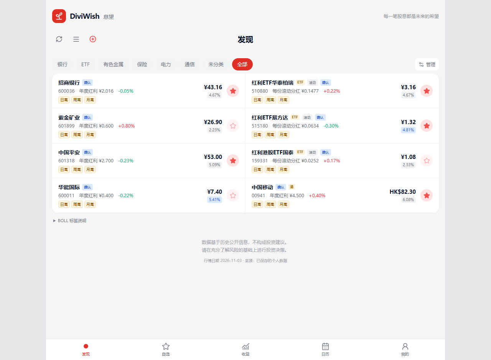

# DiviWish · 息望

面向 A 股、港股和沪深 ETF 的股息观察工具。本地使用，无需注册或登录；观察列表和设置保存在自己的设备上。

[安装并开始使用](docs/setup.md) · [完整功能与截图](../README.md) · [更新记录](docs/release-notes.md)

## 预估股息率（2026-11-06）

- 个股详情支持当前财年全年股息预估：优先核实分红承诺，否则采用盈利预测或利润 TTM 与历史支付率。
- 可选用预估口径计算目标价格与网格；支持查看来源、条件性下限和人工补充。预估口径不计算历史分位。
- 新增利润、权益工具扣减与股本核对；分开查看已实施、待实施、预案、条件指引和剩余普通分红预测。资料不足可补充利润及股数依据。

## 本次更新（2026-11-03）

- Windows 与 Linux 均支持一键安装、构建和启动；后续复用未变化的依赖和页面。

- 刷新后先显示新价格，再获取或复用当天分红。
- 分红按北京时间自然日首次成功获取后缓存，当天重复刷新和新标的预览复用结果。当天已获取的分红保留在本机，后续刷新和添加预览都能复用。
- 批量刷新没查完的标的，下次优先继续；ETF 手工除息日与查询日期合并去重。

## 主要功能

- **观察股票和 ETF**：名称／代码搜索、市场筛选、自选星标和自定义板块。
- **跟踪分红**：年度与滚动股息率、分红确认、ETF 每份派息及逐次记录。
- **比较估值位置**：按保存口径查看历史分位、30／60／90 分位及对应价格，自定义目标股息率和买卖价格网格；独立设置买入、卖出起止股息率，买入逐档递增、卖出逐档递减。
- **查看价格通道**：列表日／周／月 BOLL 标签，详情切换周期查看轨道。
- **排行与日历**：股息率排行、A/H 对比、年内涨跌、个股支付率和月度除息日历。

截图使用示例数据，不代表实时行情或分红预测。

## 开始使用

1. 安装 Node.js 24+ 后，Windows 双击 `run.cmd`，Linux 运行 `./run.sh`，自动安装依赖、构建并启动；打开网站即可使用，无需登录。详见[安装指南](docs/setup.md)。
2. 刷新默认的招商银行与红利ETF，或点击“＋”添加自己的观察标的。
3. 点击星标加入自选，在详情设置口径、目标股息率和网格，前往“收益”或“日历”继续观察。

[ETF 使用说明](docs/etf.md) · [数据口径](docs/calculations.md) · [安装与配置](docs/setup.md) · [文档目录](docs/index.md)

网站信息用于观察和记录，不构成投资建议。
