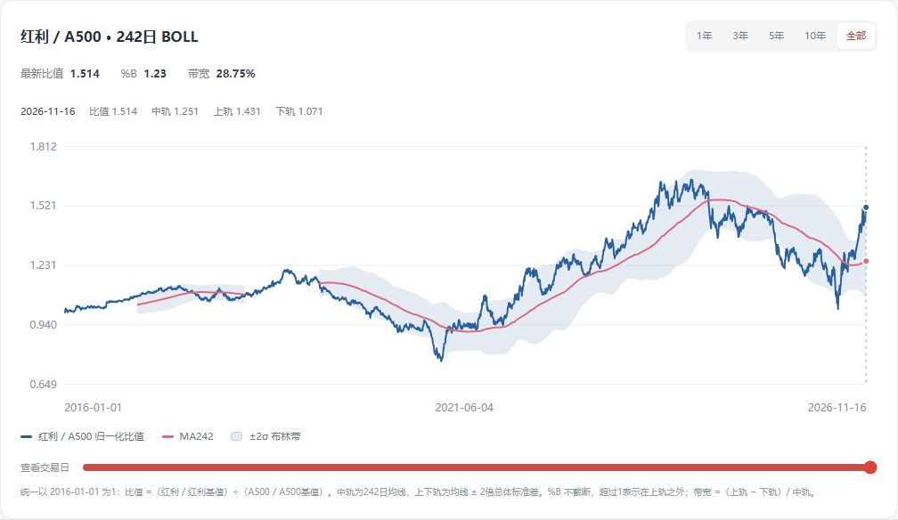
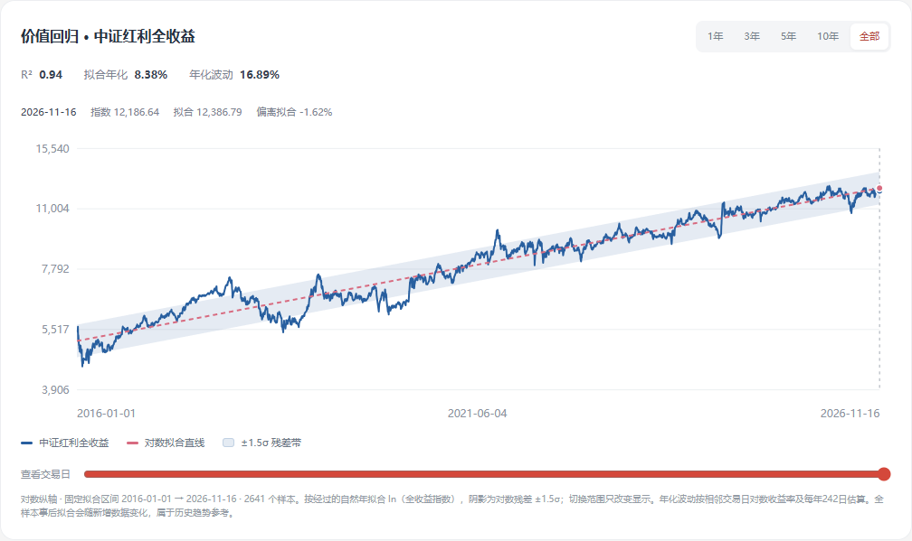

# 市场情况与40日收益差

在底部导航点击“市场”，或打开 `/discovery?view=market`。进入页面自动获取数据；“刷新数据”只更新市场指标。

## 指数与公式

- 中证红利全收益指数：`H00922`。
- 中证A500全收益指数：`000510CNY010`。
- 各指数40日涨跌幅 = `close[t] / close[t-40] - 1`。
- 40日收益差 = `红利40日涨跌幅 - A500全收益40日涨跌幅`。

40日指交易日，需要41个有效收盘值。两条指数用同一基日、同一终日；差值以百分点显示，例如红利上涨5%、A500上涨2%，收益差为+3个百分点。收益差为正表示红利相对领先；并不要求红利本身上涨。

全收益指数包含现金分红再投资，不用普通价格指数或ETF复权价格替代。两种图表分别展示收益差、两条指数各自的滚动40日涨跌幅；切换时间范围只改变展示区间，不改变40日计算窗口。

## 数据来源与更新

历史日线来自中证官方 `https://www.csindex.com.cn/csindex-home/perf/index-perf`，使用 `indexCode`、`startDate`、`endDate` 参数。请求2016-01-01起的可用历史，供长期比值BOLL与对数回归共同使用；两条指数各请求一次。官方资料：[中证红利指数单张](https://oss-ch.csindex.com.cn/static/html/csindex/public/uploads/indices/detail/files/zh_CN/000922factsheet.pdf)、[包含A500全收益代码的编制方案](https://oss-ch.csindex.com.cn/static/html/csindex/public/uploads/indices/detail/files/zh_CN/932469_Index_Methodology_cn.pdf)。

北京时间16:00前仅纳入前一自然日及以前的已发布日线，16:00后可纳入当日已发布收盘值。周末、节假日以数据源最近交易日为准；始终展示实际数据日期。两指数尾部日期不同时只展示最近共同交易日并提示。单边缺失交易日使相关40日窗口无效，不压缩窗口，也不补0；近期窗口不完整则返回错误或上次成功结果。

进程内只缓存已完成的公开结果，正常复用30分钟，手动刷新最短间隔1分钟；计算截止日变化时重新获取。接口失败后1分钟内不重复请求；已有结果则返回 `stale: true` 与警告，无历史成功结果则返回502。重启或Worker实例切换后缓存可能消失；不是离线数据库。前端刷新失败时也保留当前图表。请求超时20秒，响应最多2 MiB；无外部服务密钥。

多人版接口继续要求有效登录，公开指数缓存不含用户信息；两版均不修改股票、分红或用户数据库，不需要迁移。

## 红利／A500比值的242日BOLL

以2016-01-01起首个共同有效日为固定基日，`R[t] = (红利[t] / 红利[基日]) / (A500[t] / A500[基日])`，基日比值为1。大盘比较始终使用中证A500**全收益**，不使用普通A500价格指数。

- 中轨：含当日的最近242个连续共同交易日比值的简单均值。
- 标准差：同一242日窗口的总体标准差（分母242）。上下轨：中轨 ± 2σ。
- `%B = (R - 下轨) / (上轨 - 下轨)`，不截断；超过1或小于0表示处于轨道之外。平坦带的%B无定义，显示“—”。
- 带宽：`(上轨 - 下轨) / 中轨`，以百分比显示。

前241个有效观察日只画比值；任一指数缺失日期则重置连续窗口，满242个共同有效日后再画带。显示范围切换不重置基日、不重新缩短计算窗口。标准差口径参照[John Bollinger的原始说明](https://www.bollingerbands.com/bollinger-bands)。

## 价值回归：红利全收益的对数趋势

对固定完整历史拟合 `ln(中证红利全收益收盘值) = a + b × 经过的自然年`，自然年以365.25日换算。使用最小二乘，纵轴为对数坐标，因此指数增长的拟合线在图中表现为直线。阴影带为对数残差 ±1.5σ；σ采用回归残差标准误 `sqrt(SSE / (n - 2))`，再指数变换回指数点位。

R²在对数空间计算；拟合年化为`exp(b) - 1`；年化波动为相邻有效交易日对数收益率的样本标准差乘`sqrt(242)`。平坦序列的R²无定义，显示“—”。切换1／3／5／10年或全部，只裁剪显示，不重新拟合；区间和样本数随图显示。

这里的“价值回归”是全样本事后历史趋势拟合，新增样本会使历史拟合线与残差带变化，不是逐日当时可知的公允价值，也不外推未来。参考用户第二张图的对数拟合与1.5σ带；最小二乘原理见[NIST说明](https://www.itl.nist.gov/div898/handbook/pmd/section1/pmd141.htm)。

## 验证

从 `web/` 运行 `npm run check`。`worker/tests/market.test.ts` 覆盖41个收盘值、相减方向、日期对齐、缺失窗口、非法指数/日期/收盘值、缓存及失败恢复；`market-analysis.test.ts` 另覆盖242日首个有效值、归一化、总体标准差、缺失窗口重置、平坦%B、已知指数增长、残差自由度、R²与年化波动；`market-api.test.ts` 覆盖HTTP接口，多人版另检查未登录拒绝访问。

参考文章：[用户提供的40日收益差文章](https://mp.weixin.qq.com/s/ZI1KEZ_02F5YpN1Kgl1pMg)。开发时该链接返回微信验证页，页面按用户明确给出的计算公式实现，没有引入文章中尚未核实的阈值或买卖信号。
